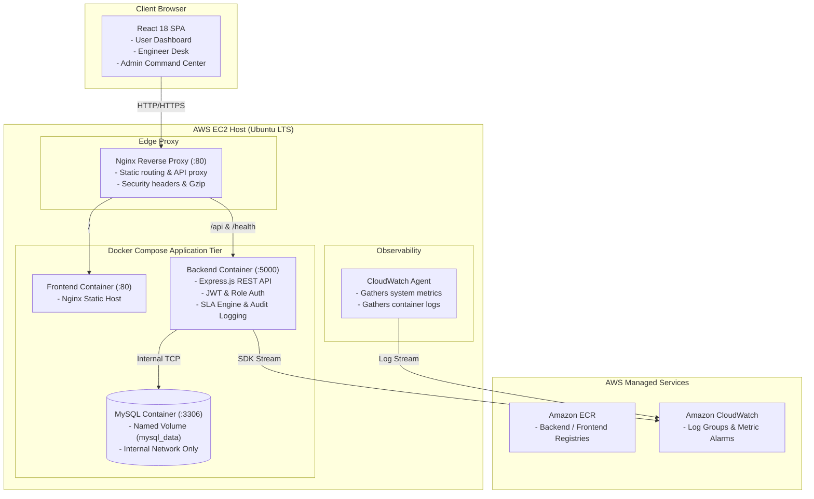

# Cloud IT Support & Incident Management System

A robust, enterprise-grade, cloud-native IT Support & Incident Management platform built with React, Node.js/Express, MySQL, Docker, Nginx, GitHub Actions, AWS EC2, and Amazon CloudWatch.


---

## 1. Project Overview

The **Cloud IT Support & Incident Management System** provides centralized IT service operations for organizations. It features:
- **Role-Based Portals**:
  - **End Users**: Raise incidents, track SLA countdowns, review activity history, and collaborate on resolutions.
  - **Support Engineers**: Triage incoming tickets, accept unassigned incidents, manage lifecycles, and record resolution notes.
  - **Administrators**: System-wide operational dashboard, workload metrics, configurable SLA targets, and user/role administration.
- **Configurable SLA Policies**: Configurable response targets (Critical: 15m, High: 1h, Medium: 4h, Low: 8h) with real-time breach detection and countdown indicators.
- **Audit History & Activity Logs**: Full tracking of status transitions, engineer assignments, comments, and priority updates.
- **CloudWatch Observability**: Centralized logging of application startup, authentication events, API latency, and lifecycle actions.
- **Automated CI/CD**: Zero-secret AWS OIDC integration in GitHub Actions building and deploying to AWS EC2.

---

## 2. Architecture Diagram



---

## 3. Technology Stack

- **Frontend**: React.js 18, React Router v6, Tailwind CSS, Lucide Icons, Vite
- **Backend**: Node.js 20, Express.js, JWT, bcryptjs, Helmet, Morgan, Winston, express-validator
- **Database**: MySQL 8.0 (InnoDB, UTF8mb4, connection pooling, parameterized queries)
- **Containerization**: Docker, Docker Compose (multi-stage builds, healthchecks)
- **Reverse Proxy**: Nginx 1.25 Alpine
- **CI/CD**: GitHub Actions (OIDC passwordless AWS authentication)
- **Cloud Infrastructure**: AWS EC2 (Ubuntu 22.04 LTS), Amazon ECR
- **Observability**: AWS CloudWatch (Logs & Metrics)
- **Operating System**: Linux (Ubuntu), Bash automation scripting
- **Version Control**: Git & GitHub

---

## 4. Folder Structure

```
cloud-incident-management/
├── .github/
│   └── workflows/
│       └── deploy.yml            # CI/CD Pipeline (Build, Test, ECR Push, EC2 Deploy)
├── backend/
│   ├── src/
│   │   ├── config/               # Database pool & Winston logger configuration
│   │   ├── controllers/          # Request handlers (auth, tickets, comments, SLA, users)
│   │   ├── middleware/           # JWT auth, role validation, error handling
│   │   ├── models/               # MySQL parameterized query models
│   │   ├── routes/               # Express REST route definitions
│   │   ├── utils/                # SLA calculator, audit logger, CloudWatch stream
│   │   ├── app.js                # Express app setup and middleware
│   │   └── server.js             # HTTP server bootstrap and graceful shutdown
│   ├── tests/                    # Jest automated unit & integration test suite
│   ├── Dockerfile                # Multi-stage production container
│   └── package.json
├── frontend/
│   ├── src/
│   │   ├── api/                  # Axios REST API clients with JWT interceptor
│   │   ├── components/           # Badges, SLA timers, tables, stats cards, navbar
│   │   ├── context/              # Authentication context & session state
│   │   ├── pages/                # Dashboards, login, register, ticket detail, users
│   │   ├── App.jsx               # Client routes & role-based routing guards
│   │   ├── index.css             # Tailwind CSS directives
│   │   └── main.jsx
│   ├── Dockerfile                # Multi-stage React builder & Nginx container
│   ├── nginx.conf                # Client-side routing fallback configuration
│   └── vite.config.js
├── database/
│   ├── schema.sql                # Relational DDL definitions & table constraints
│   ├── seed.sql                  # Initial accounts, SLA targets, and sample incidents
│   └── init.sql                  # Automated Docker entrypoint initialization
├── nginx/
│   ├── nginx.conf                # Gateway core configuration
│   └── default.conf              # Reverse proxy routing rules (/api -> backend, / -> frontend)
├── scripts/
│   ├── deploy.sh                 # Zero-downtime EC2 pulling & deployment script
│   ├── backup.sh                 # Automated mysqldump backup with compression
│   ├── restore.sh                # Database restoration script
│   ├── validate-backup.sh        # Backup integrity validation script
│   └── setup-ec2.sh              # EC2 Ubuntu provisioning script
├── cloudwatch/
│   ├── amazon-cloudwatch-agent.json  # CloudWatch Agent metrics & logs configuration
│   └── setup-cloudwatch.sh           # CloudWatch Agent installer
├── docs/
│   ├── ARCHITECTURE.md           # Deep-dive architecture and design patterns
│   ├── API_DOCUMENTATION.md      # Exhaustive REST API endpoint specifications
│   ├── AWS_DEPLOYMENT_GUIDE.md   # Step-by-step AWS console & CLI deployment instructions
│   └── BACKUP_AND_DISASTER_RECOVERY.md # Backup, verification, and recovery procedures
├── docker-compose.yml            # Multi-container orchestration (MySQL, Backend, Frontend, Nginx)
├── .env.example                  # Environment configuration template
├── .gitignore
└── README.md
```

---

## 5. Prerequisites

- **Node.js**: v18.x or v20.x+
- **npm**: v9.x or v10.x+
- **Docker & Docker Compose**: v24.x+ / Compose v2.x+
- **Git**

---

## 6. Quick Start: Local Development

### 1. Clone the repository
```bash
git clone https://github.com/<YOUR_USER>/cloud-incident-management.git
cd cloud-incident-management
```

### 2. Configure Environment Variables
```bash
cp .env.example .env
cp backend/.env.example backend/.env
```

### 3. Run with Docker Compose
The fastest way to start all 4 services (Frontend, Backend, MySQL, Nginx):
```bash
docker compose up -d --build
```

Access the application:
- **Web Application**: [http://localhost](http://localhost)
- **API Health Check**: [http://localhost/health](http://localhost/health)
- **API Endpoints**: [http://localhost/api/](http://localhost/api/)

---

## 7. Default Credentials for Testing

The database automatically seeds 3 ready-to-test accounts:

| Role | Email | Password | Access Capabilities |
| :--- | :--- | :--- | :--- |
| **Admin** | `admin@cloudsupport.local` | `Admin@123` | Full control: SLA targets, user roles, all incidents |
| **Support Engineer** | `engineer@cloudsupport.local` | `Engineer@123` | Triage, self-assignment, resolve incidents, internal notes |
| **End User** | `user@cloudsupport.local` | `User@123` | Raise tickets, track SLA countdowns, add public comments |

*(Quick-login buttons are built into the Login screen for instant testing)*

---

## 8. Running Automated Tests

Run backend unit and integration test suite:
```bash
cd backend
npm test
```

Expected test results:
```
PASS tests/sla.test.js
PASS tests/auth.test.js
PASS tests/health.test.js
PASS tests/tickets.test.js

Test Suites: 4 passed, 4 total
Tests:       21 passed, 21 total
```

Build React frontend:
```bash
cd frontend
npm run build
```

---

## 9. API Endpoints Overview

| Method | Endpoint | Access | Description |
| :--- | :--- | :--- | :--- |
| `GET` | `/health` | Public | System and database health status |
| `POST` | `/api/auth/register` | Public | Register a new user |
| `POST` | `/api/auth/login` | Public | Authenticate user & issue JWT |
| `GET` | `/api/auth/me` | Auth | Current user profile |
| `GET` | `/api/tickets` | Auth | List incidents with filters & role segregation |
| `POST` | `/api/tickets` | Auth | Create a new incident (calculates SLA deadline) |
| `GET` | `/api/tickets/:id` | Auth | Incident details with comments & audit history |
| `PUT` | `/api/tickets/:id/status` | Auth | Update incident lifecycle status |
| `PUT` | `/api/tickets/:id/assign` | Staff | Assign incident to an engineer |
| `PUT` | `/api/tickets/:id/priority` | Staff | Adjust priority and recalculate SLA deadline |
| `POST` | `/api/tickets/:id/comments` | Auth | Add public comment or internal staff note |
| `GET` | `/api/dashboard/stats` | Auth | Retrieve role-specific metrics |
| `GET` | `/api/sla/configs` | Auth | Retrieve configurable SLA policies |
| `PUT` | `/api/sla/configs` | Admin | Update SLA resolution time for priority |
| `GET` | `/api/users` | Staff | List users for assignment and admin |
| `PUT` | `/api/users/:id/role` | Admin | Change user role (`user`, `engineer`, `admin`) |

*For complete schema payloads and curl examples, see [docs/API_DOCUMENTATION.md](file:///C:/Users/kotap/.gemini/antigravity/scratch/cloud-incident-management/docs/API_DOCUMENTATION.md).*

---

## 10. Database Backup & Recovery

- **Automated Nightly Backup**: Scheduled via cron at 02:00 UTC.
- **Manual Backup**:
  ```bash
  bash scripts/backup.sh
  ```
- **Backup Verification**:
  ```bash
  bash scripts/validate-backup.sh ~/backups/mysql/incident_backup_20260101_120000.sql.gz
  ```
- **Database Restoration**:
  ```bash
  bash scripts/restore.sh ~/backups/mysql/incident_backup_20260101_120000.sql.gz
  ```

*For complete recovery instructions, see [docs/BACKUP_AND_DISASTER_RECOVERY.md](file:///C:/Users/kotap/.gemini/antigravity/scratch/cloud-incident-management/docs/BACKUP_AND_DISASTER_RECOVERY.md).*

---

## 11. CI/CD & AWS Deployment

The GitHub Actions workflow (`.github/workflows/deploy.yml`):
1. Runs automated tests and builds frontend assets.
2. Uses **GitHub Actions OIDC** to securely assume an AWS IAM Role without storing access keys.
3. Builds and pushes production Docker images to **Amazon ECR**.
4. Securely connects to **AWS EC2** via SSH and executes `scripts/deploy.sh` to update containers with zero data loss.

*For step-by-step AWS console and OIDC configuration instructions, see [docs/AWS_DEPLOYMENT_GUIDE.md](file:///C:/Users/kotap/.gemini/antigravity/scratch/cloud-incident-management/docs/AWS_DEPLOYMENT_GUIDE.md).*

---

## 12. Troubleshooting Guide

### 1. Database Connection Errors on Startup
- Ensure the MySQL container is healthy (`docker compose ps`).
- Check database logs: `docker compose logs mysql`.
- Verify credentials in `.env` match `DB_USER` and `DB_PASSWORD`.

### 2. CloudWatch Logs Not Appearing
- Ensure the EC2 instance has the `CloudWatchAgentServerPolicy` attached to its IAM instance profile.
- Verify `ENABLE_CLOUDWATCH=true` in `.env`.
- Check agent service: `sudo /opt/aws/amazon-cloudwatch-agent/bin/amazon-cloudwatch-agent-ctl -a status`.

### 3. Permission Denied on Linux Scripts
- Make scripts executable: `chmod +x scripts/*.sh cloudwatch/*.sh`.
