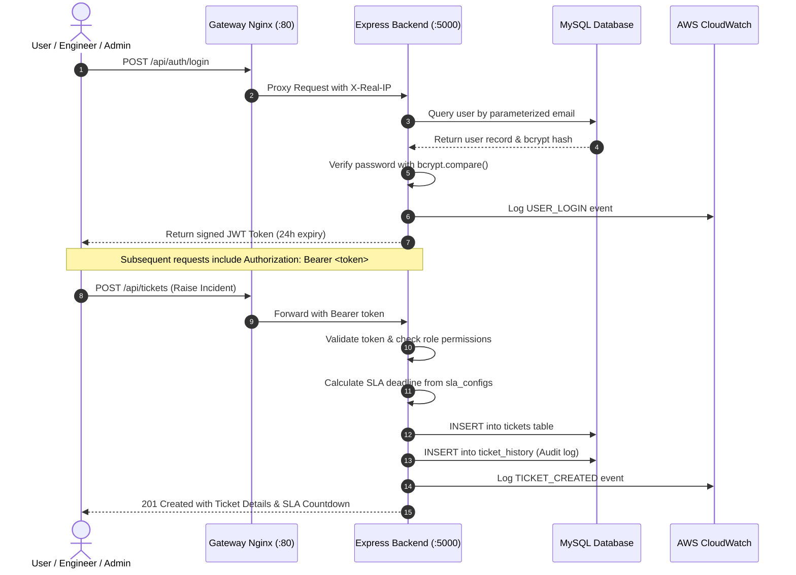
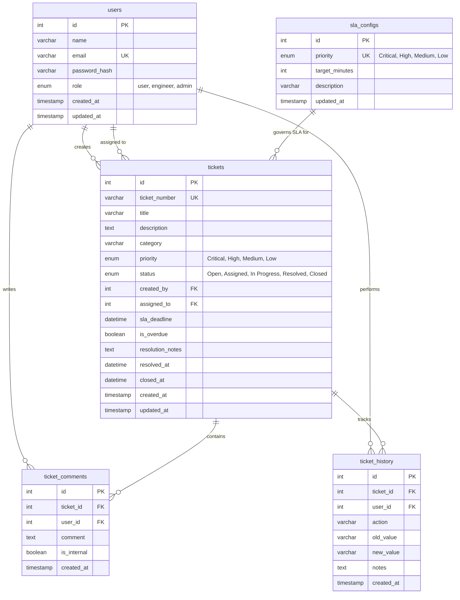

# Architecture Overview: Cloud IT Support & Incident Management System

## 1. System Architecture

The **Cloud IT Support & Incident Management System** is built on a containerized multi-tier architecture designed for high availability, security, and maintainability on AWS EC2.

```mermaid
flowchart TD
    subgraph Client["End Users & Support Staff"]
        Browser["Modern Web Browser (React 18 SPA)"]
    end

    subgraph Host["AWS EC2 Host (Ubuntu Linux)"]
        subgraph Gateway["Edge Tier"]
            Nginx["Nginx Reverse Proxy (:80 / :443)\n- Gzip & Rate Limiting\n- Security Headers (CSP, HSTS)\n- SSL Termination"]
        end

        subgraph ContainerTier["Application Tier (Docker Compose)"]
            Frontend["Frontend Service (:80)\n- Nginx Static Asset Server\n- Client SPA Routing"]
            Backend["Backend Service (:5000)\n- Express.js REST API\n- JWT & Role Authorization\n- SLA Engine & Audit Logger\n- Winston Structured Logs"]
        end

        subgraph DataTier["Data Tier"]
            MySQL[("MySQL 8.0 Database (:3306)\n- Named Persistent Volume (mysql_data)\n- Parameterized Queries\n- InnoDB UTF8mb4")]
        end

        subgraph MonitoringTier["Host Agent Tier"]
            CWAgent["Amazon CloudWatch Agent\n- Gathers log files & container metrics\n- Streams to CloudWatch Logs"]
        end
    end

    subgraph AWSCloud["AWS Managed Services"]
        ECR["Amazon ECR\n- Private Container Registries"]
        CloudWatch["Amazon CloudWatch\n- Log Groups & Alarms\n- CPU/Memory Metrics"]
    end

    subgraph CICD["GitHub Actions CI/CD"]
        GHA["GitHub Actions Runner\n- OIDC Authentication\n- Docker Buildx & Push\n- Automated SSH Deploy"]
    end

    Browser -->|HTTP/HTTPS Requests| Nginx
    Nginx -->|Proxy / | Frontend
    Nginx -->|Proxy /api and /health| Backend
    Backend -->|Internal SQL Pool (TCP)| MySQL
    Backend -->|Direct Event Stream (SDK)| CloudWatch
    CWAgent -->|Collects /var/log & volumes| CloudWatch
    GHA -->|OIDC Token Exchange| AWSCloud
    GHA -->|Push Images| ECR
    GHA -->|SSH Deploy Command| Host
```

---

## 2. Request Flow & Security Architecture



---

## 3. Relational Database Schema (ERD)



---

## 4. Key Design Decisions

1. **Role-Based Access Control (RBAC)**:
   - Three segregated tiers: `user` (end-user), `engineer` (technical support), and `admin` (management).
   - Middleware enforces authorization on every API endpoint.
   - Internal notes on tickets are strictly sanitized and never returned to standard end-users.

2. **Configurable Dynamic SLA Engine**:
   - Rather than hardcoding SLA windows, values are sourced from `sla_configs` table in MySQL and cached in-memory with TTL.
   - When administrators update policies, cache is automatically invalidated.
   - Overdue status is computed dynamically in SQL (`NOW() > sla_deadline`) preventing stale boolean flags.

3. **Production Containerization**:
   - MySQL data is stored in named persistent volume `mysql_data`, ensuring zero data loss across container recreations.
   - Database port 3306 is isolated within Docker private bridge network `app-network` and is never exposed to the host network.
   - Gateway Nginx provides unified entry point on port 80, handling SPA client-side routing fallback and API proxying.

4. **Zero-Secret CI/CD with AWS OIDC**:
   - GitHub Actions connects to AWS using OpenID Connect (OIDC) federated role assumption, eliminating permanent AWS access keys in GitHub Secrets.
